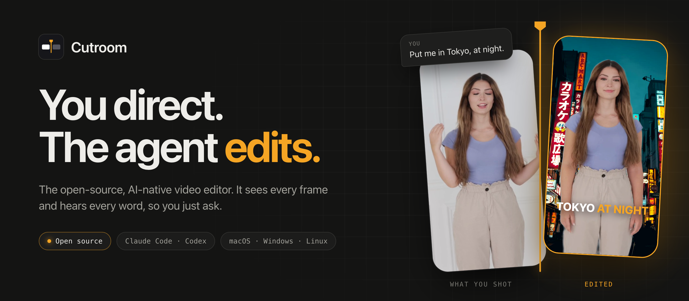
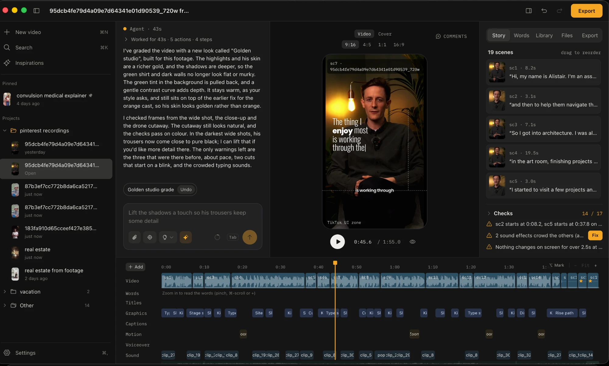

<p align="center">
  
</p>

<h1 align="center">Cutroom</h1>

<p align="center">
  <strong>You direct. The agent edits.</strong><br>
  A video editor built from the ground up for AI. It sees every frame and hears every word,<br>
  so you can just ask for the edit you want.
</p>

<p align="center">
  <a href="https://github.com/Chigala/cutroom-releases/releases/latest/download/Cutroom-arm64.dmg"><strong>Download for Mac (Apple silicon)</strong></a>
  ·
  <a href="https://github.com/Chigala/cutroom-releases/releases/latest/download/Cutroom-x64.dmg">Intel</a>
  ·
  <a href="https://getcutroom.studio">Website</a>
  ·
  <a href="docs/development.md">Build from source</a>
</p>

<p align="center">
  <a href="https://github.com/Chigala/cutroom-releases/releases/latest"></a>
  <a href="LICENSE"></a>
  
</p>

<p align="center">
  
</p>

## What it is

Drop in raw footage and Cutroom understands it: every word said, the pauses, the shots, the faces, the
beat of the music. The agent makes the first cut on its own (retakes and dead air gone, a hook,
captions, zooms, music, graphics designed for this video), then you change anything by saying what you
want, pointing at the video, or editing the words.

Every change shows up as a chip you can keep or undo. Nothing is a black box: the edit is a folder of
plain files you can open in any editor.

- **It sees your footage.** Transcription, faces, people, cutouts, shots, beats and sound events, all
  worked out on your computer. So it can put a title behind someone, swap a background or land a cut on
  a laugh.
- **Edit by asking.** "Make the hook punchier", "tighten the middle", "add a zoom on every laugh". The
  agent reads the transcript, looks at the frames it needs, makes the change and checks its own work
  before it hands it back.
- **Edit by hand, too.** Trim on the timeline, cut words in the transcript, point at a spot on the
  video and comment on it. The agent picks up your changes.
- **Learn a style from a video you love.** Drop one in and Cutroom measures its cuts, punch-ins, beat,
  sound effects and captions, and writes it up as an inspiration to edit any video to.
- **Every video its own design.** Graphics, fonts and colours are designed for each video's subject and
  kept apart from your recent ones, so no two edits look alike.
- **Checks before you post.** Hook timing, safe zones for TikTok, Reels and Shorts, captions, dead air,
  beat sync, loudness. Most have a one-click fix.
- **Export anywhere.** MP4 in 9:16, 4:5, 1:1 or 16:9, mastered to -14 LUFS, with a cover image.

## Your agent, your footage

Cutroom runs on your own plan, through the agent you already use: **Claude Code** (on a Claude plan) or
**Codex** (on a ChatGPT plan). Sign in once: there's no API key to set, and nothing to pay beyond the
plan you have.

Your video files never leave your computer. Transcription, indexing, preview and export all run
locally; the agent reads the project's files, the transcript and the few frames it asks to look at, the
way a coding agent reads a code project.

## Install

| | |
|---|---|
| **macOS** 13.3 or later | [Apple silicon](https://github.com/Chigala/cutroom-releases/releases/latest/download/Cutroom-arm64.dmg) · [Intel](https://github.com/Chigala/cutroom-releases/releases/latest/download/Cutroom-x64.dmg), signed and notarized |
| **Windows** 10 or later | [Installer](https://github.com/Chigala/cutroom-releases/releases/latest/download/Cutroom-Setup.exe) (preview) |
| **Linux** x64 | [AppImage](https://github.com/Chigala/cutroom-releases/releases/latest/download/Cutroom-x86_64.AppImage) · [.deb](https://github.com/Chigala/cutroom-releases/releases/latest/download/cutroom_amd64.deb) (preview) |

The app updates itself. Speech recognition downloads the first time you import a clip.

Windows and Linux are new: they work, but expect rough edges, and please
[report them](https://github.com/Chigala/cutroom/issues).

## The project is a folder

The video is a pure function of its folder. Everything the agent and the UI do is a recorded change to
these files, so undo, history, restore points and "what did the AI change" all come from one place.
Edit a file by hand and the change shows up in the app, undoable like any other.

```
My Video/
  project.json              name, format
  STYLE.md                  your taste in plain words; the agent follows it
  design.json               this video's design: palette, fonts, motion
  timeline/scenes.json      the cut, in playback order
  captions/captions.json    caption style, word fixes and emphasis
  graphics/*.html           motion graphics, written for this video
  overlays/visuals.json     graphics, cutaways and memes placed in time
  audio/music.json          music, volume, ducking
  cover.json                the thumbnail
  .history/                 every change, and the chat
```

## Build from source

You need Node 22.12+, Git and pnpm (`corepack enable` sets up the pinned version).

```bash
git clone https://github.com/Chigala/cutroom.git && cd cutroom
corepack enable
pnpm install
pnpm dev
```

`pnpm check` runs the linter, type checks and tests. [docs/development.md](docs/development.md) has the
rest: platform setup, packaging installers, what runs where, and a map of the code.

## Contributing

Issues and pull requests are welcome. Read [CONTRIBUTING.md](CONTRIBUTING.md) first; for anything big,
open an issue to talk it through before you build it.

## License

Cutroom is open source under the [GNU AGPL-3.0](LICENSE). You can use, study, change and share it; if
you run a modified version as a service for others, you share your changes under the same license.

Cutroom renders video with [Remotion](https://www.remotion.dev), which has its own
[license](https://www.remotion.dev/license): free for individuals and small companies, while larger
companies need a Remotion company license. Everything else Cutroom builds on, bundles or downloads, and
its license, is listed in [THIRD_PARTY_NOTICES.md](THIRD_PARTY_NOTICES.md).
